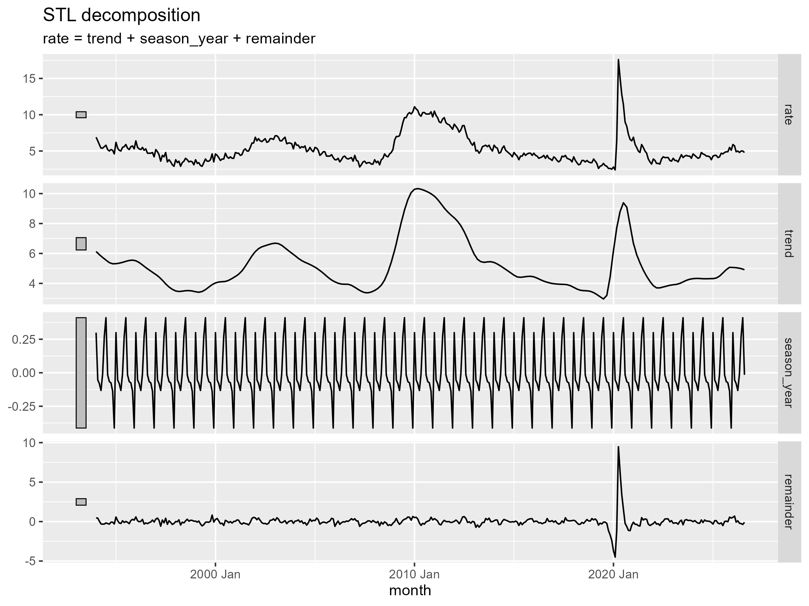

# Exploratory Data Analysis: Seattle Unemployment (SEAT653URN)

Monthly, not seasonally adjusted, Jan 1994 to Aug 2026. Code: `04_eda.R`.

- **Level and range:** observations usually lie between 2.5% and 7.5%; about 11% in the Great Recession and 17.5% in April 2020.
- **Recessions:** the dot-com bust (2001–03), the Great Recession (2008–10) and COVID (2020). The Great Recession rose slowly and took years to recover. COVID was the largest spike but recovered within about a year, and STL places most of it in the remainder (a one-off shock) rather than the trend.
- **Seasonality:** observed small but real, about ±0.4 points. Highest in July (+0.41), January (+0.30) and June (+0.27). By far lowest in December (−0.41). Likely causes: seasonal jobs ending after the holidays, graduates and school-year workers job-hunting in summer, and holiday hiring in December.
- **Stationarity:** the rate itself is not stationary (its ACF fades slowly). Month-over-month changes are close to stationary, apart from spikes at lags 12, 24 and 36 from leftover seasonality. Models should work on monthly changes and include a seasonal component.
- **Missing data:** October 2025 is missing due to the federal government shutdown and was filled with September 2025's value (1 of about 390 months).

