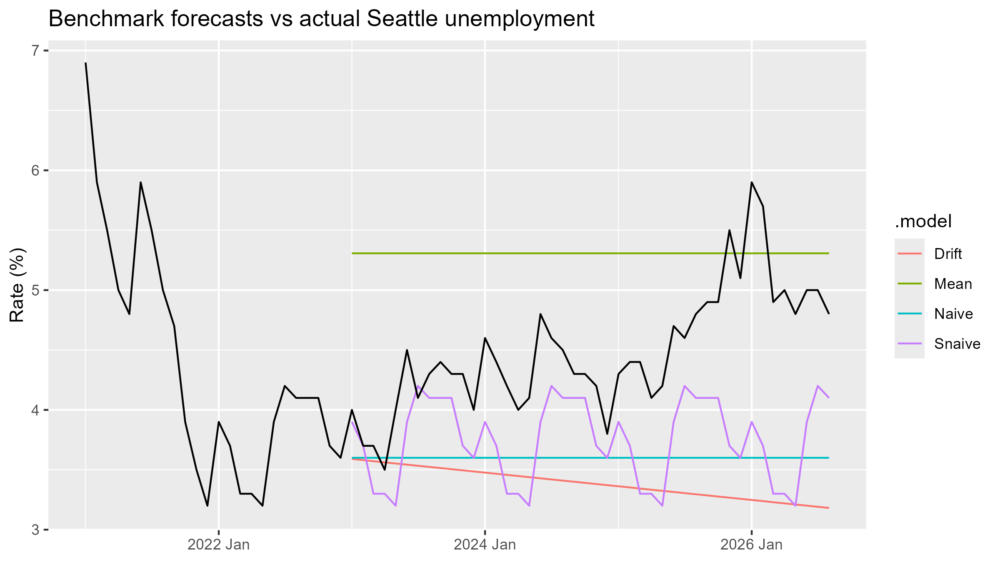
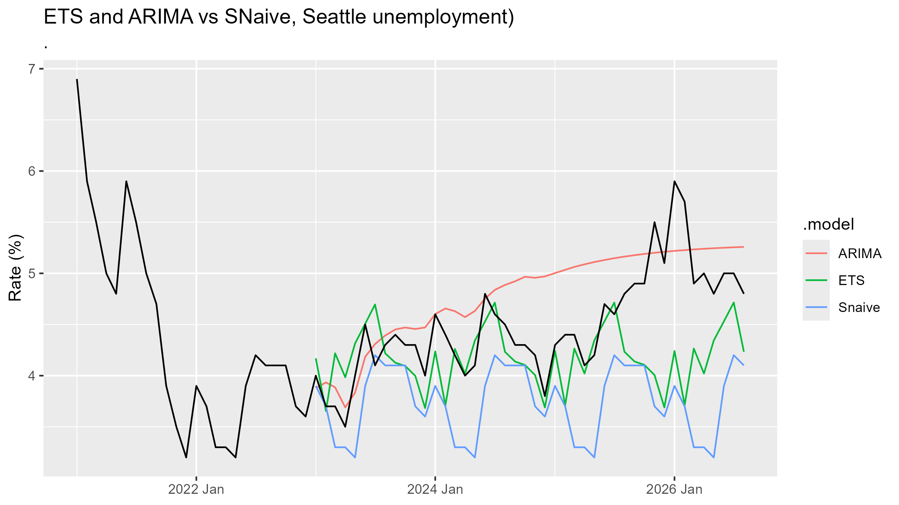
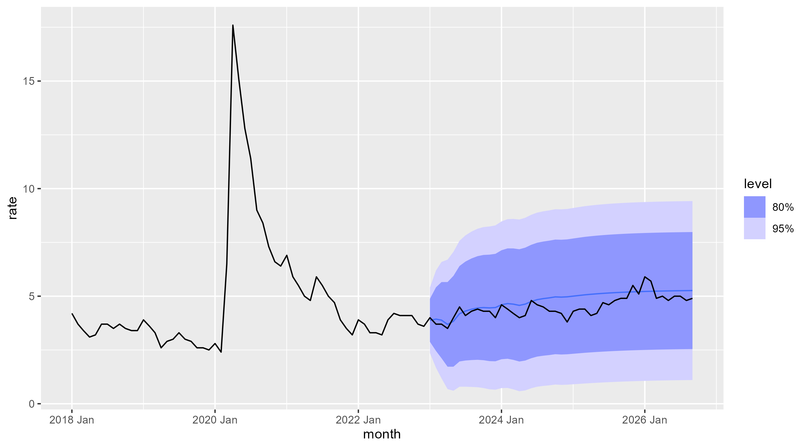

## Benchmarks (05_benchmarks.R)
Benchmarks (train 1994–2022, test Jan 2023–Aug 2026): 
Best = SNaive, RMSE 0.91, MAE 0.75, MAPE 15.9%. 

This is the bar ETS/ARIMA must beat.

## ETS and ARIMA (06_ets_arima.R), first look
- Data now read from a local copy (SEAT653URN.csv); FRED was down for maintenance.
- ETS picked ETS(M,Ad,A): alpha ≈ 1 (follows last month), fixed seasonality, damped trend.
- ARIMA picked ARIMA(1,0,1)(0,0,2)[12] w/ mean: no differencing, ar1 = 0.89,
  reverts to a long-run mean of ~5.3% (matches the 5.2% Power BI average).
- Eyeball: ARIMA catches the 2025–26 rise in level but not seasonality;
  ETS looks like a slightly better SNaive. Accuracy table on Mon Oct 26.
  

  
  
## Diagnostics (07_compare.R)
- Outside of 2020, the model's misses look like random noise: no repeating pattern by month or season. 
- The one clear exception is the April 2020 COVID shock, which no model could have predicted from past data. 
- A Ljung-Box test found no leftover pattern in the ARIMA misses (p = 0.80), while the seasonal naive benchmark failed it (p ≈ 0), so ARIMA captured the patterns the simpler model missed.

- The 95% prediction range is wide: about 1.5% to 8.5% a year out, because the 2020 spike taught the model that big shocks happen. 
- In the 2023–26 test period, all 44 months fell inside that range (100% coverage vs. the expected 95%), so the range was wider than calm times needed. 
- For budgeting, a 7-point range is too wide to plan around. 
- For credit risk, it's a reasonable reminder that reserves should be ready for the next shock, not just sized for calm years.
  

  