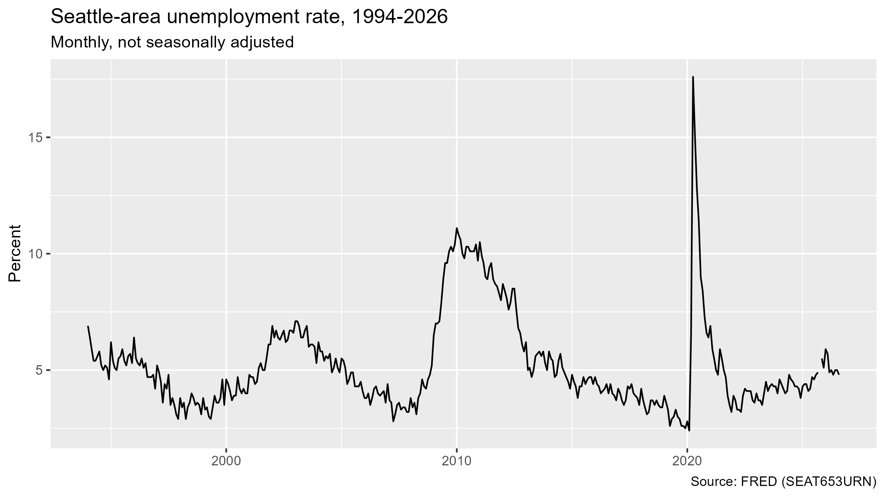
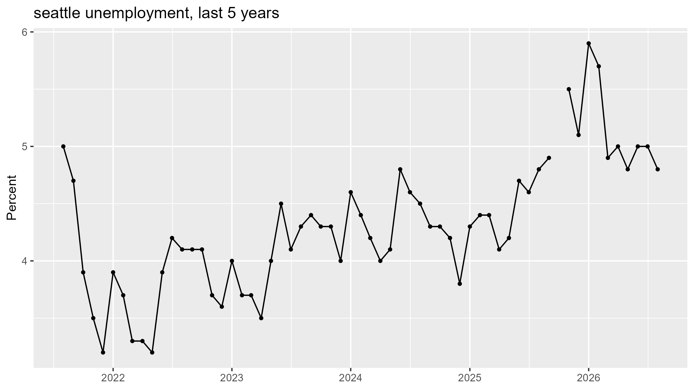
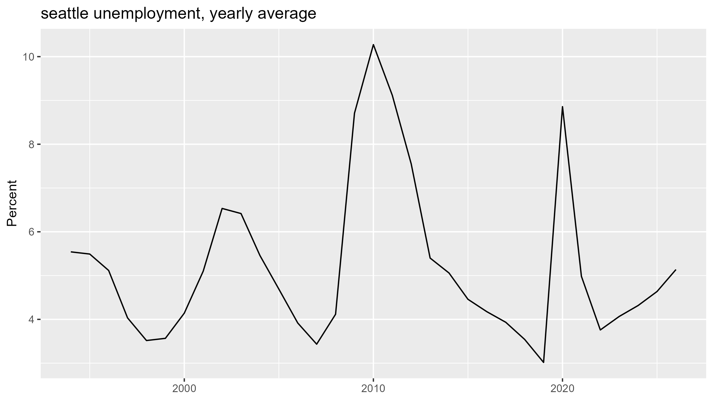

# project1-forecasting
Forecasting Seattle Unemployment

## Question
One of the strongest drivers of loan defaults is unemployment. Lenders forecast unemployment to prepare reserves to cover these losses. Seattle unemployment seems to display a clear seasonal pattern year-by-year, with a gradual rise from 3.2% in 2022 to around 5% in 2026. We also see three employment shocks and their magnitudes in 2001, 2008 and 2020. This project forecasts unemployment in the Seattle area for the next 12 months, and compares simple benchmark models to more advanced ones.

### Data: FRED series SEAT653URN (monthly, not seasonally adjusted).

## First Look

*Figure 1. Seattle-area unemployment rate, monthly, 1994–2026. Source: FRED.*
---

*Figure 2. Last 5 Years, monthly, Aug 2021 to Aug 2026. The repeating within-year pattern is seasonality. Source: FRED.*
---

*Figure 3. Yearly average. 2026 covers Jan–Aug only. 1994-2026. Source: FRED.*
---
## Files
01_pull_and_plot.R: downloads the data from FRED, summarizes it, and makes the charts above
SEAT653URN.csv: saved copy of the data
