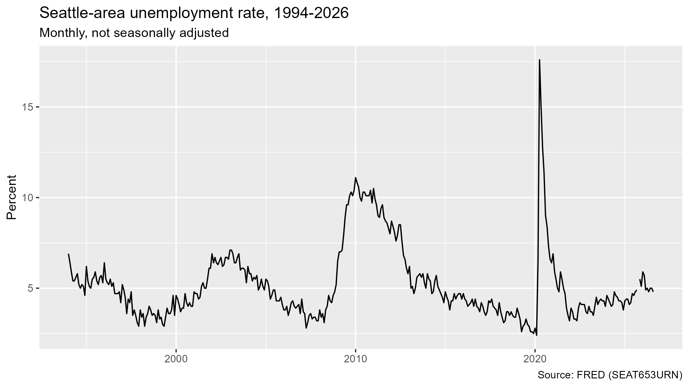
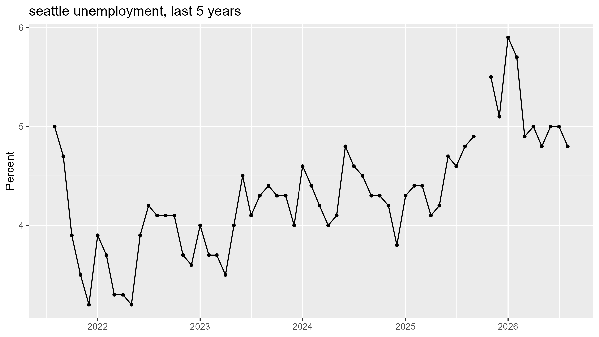
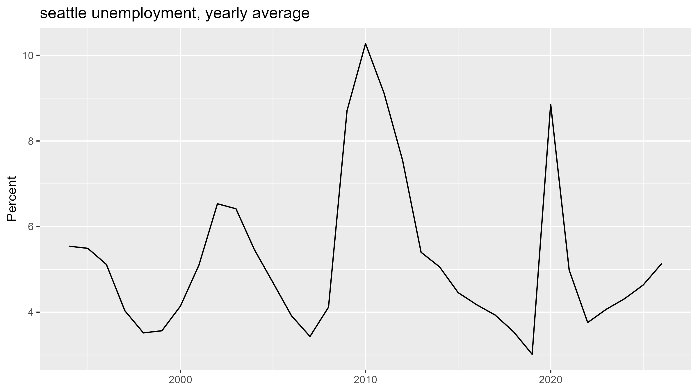

# project1-forecasting
Forecasting Seattle Unemployment

## Question
How accurately can time-series models forecast Seattle’s unemployment rate 12 months ahead, and what range should a lender plan for when setting loss reserves?

### Data: FRED series SEAT653URN (monthly, not seasonally adjusted).

## First Look

*Figure 1. Seattle-area unemployment rate, monthly, 1994–2026. Source: FRED.*
---

*Figure 2. Last 5 Years, monthly, Aug 2021 to Aug 2026. The repeating within-year pattern is seasonality. Source: FRED.*
---

*Figure 3. Yearly average. 2026 covers Jan–Aug only. 1994-2026. Source: FRED.*
---
## Files
01_pull_and_plot.R: downloads the data from FRED, summarizes it, and makes the charts above

SEAT653URN.csv: saved copy of the data
