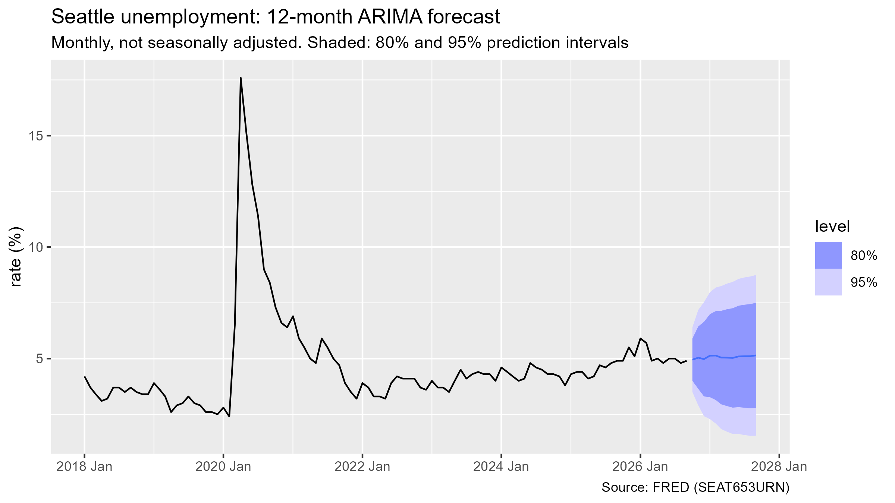

# Forecasting Seattle Unemployment for Credit Risk

**Question:** How accurately can time-series models forecast Seattle's unemployment rate 12 months ahead, and what range should a lender plan for?
**Answer:** An ARIMA model beat five alternatives on a 44-month holdout, with about half the error of the best simple benchmark. It forecasts about 5.1% unemployment in September 2027, with a 95% range of 1.5% to 8.8%.

## Key results

| Model | RMSE | MAE | MAPE |
|---|---|---|---|
| **ARIMA** | **0.47** | **0.40** | **9.0%** |
| ETS | 0.63 | 0.44 | 9.3% |
| Seasonal naive (best benchmark) | 0.91 | 0.75 | 15.9% |

- Tested on Jan 2023 to Aug 2026 (44 months the models never saw).
- ARIMA's leftover errors showed no remaining pattern (Ljung-Box p = 0.80), and all 44 test months fell inside its 95% prediction interval.
- **For a lender:** plan reserves around 5.1% and stress-test against the upper end near 8.8%. Without the 2020 COVID months, the range narrows by about a third (2.4% to 7.1%).

📄 **Full write-up:** [report.md](report.md) · Model details: [MODELS.md](MODELS.md) · Exploratory notes: [EDA.md](EDA.md)

## Data
FRED series [SEAT653URN](https://fred.stlouisfed.org/series/SEAT653URN): Seattle-Tacoma-Bellevue unemployment rate, monthly, not seasonally adjusted, Jan 1994 to Sep 2026. October 2025 is missing because of the federal government shutdown and is filled with the September value.

## Files
| File | What it does |
|---|---|
| `01_pull_and_plot.R` | Downloads the data from FRED and makes the first-look charts |
| `02_ggplot_charts.R` | Yearly averages, seasonal pattern, Seattle vs U.S. charts |
| `03_ts_basics.R` | Converts the data to a time series and explores trend and seasonality |
| `04_eda.R` | STL decomposition and autocorrelation (ACF) plots |
| `05_benchmarks.R` | Train/test split and four benchmark forecasts (mean, naive, seasonal naive, drift) |
| `06_ets_arima.R` | Fits ETS and ARIMA models |
| `07_compare.R` | Scores all six models on the test period (RMSE, MAE, MAPE) |
| `SEAT653URN.csv` | Saved copy of the FRED data |
| `report.qmd` / `report.md` | The report (source / rendered for GitHub) |
| `MODELS.md`, `EDA.md` | Working notes on models, diagnostics and exploration |
| `project1.pbix` | Power BI dashboard (screenshot in `charts/powerbi_dashboard.png`) |
| `charts/` | All charts |

**Tools:** R (tidyverse, fpp3/fable), Quarto, Power BI, Git/GitHub
