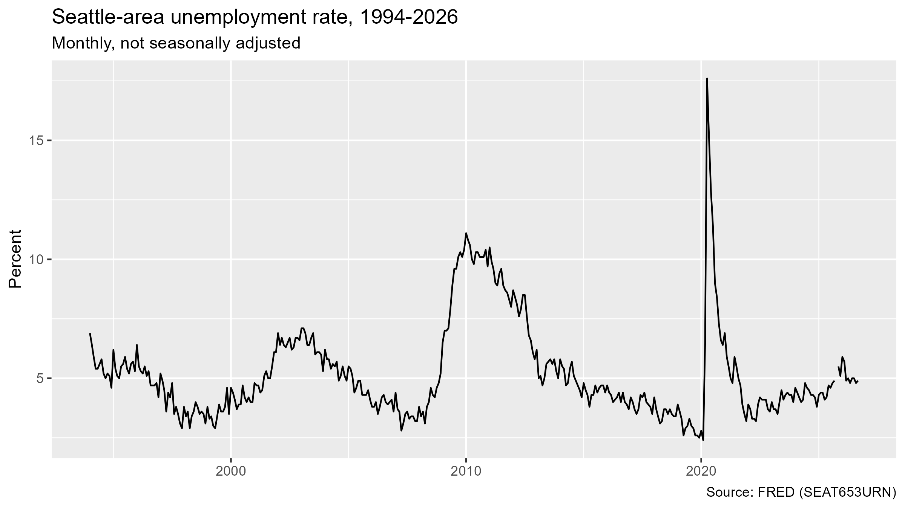
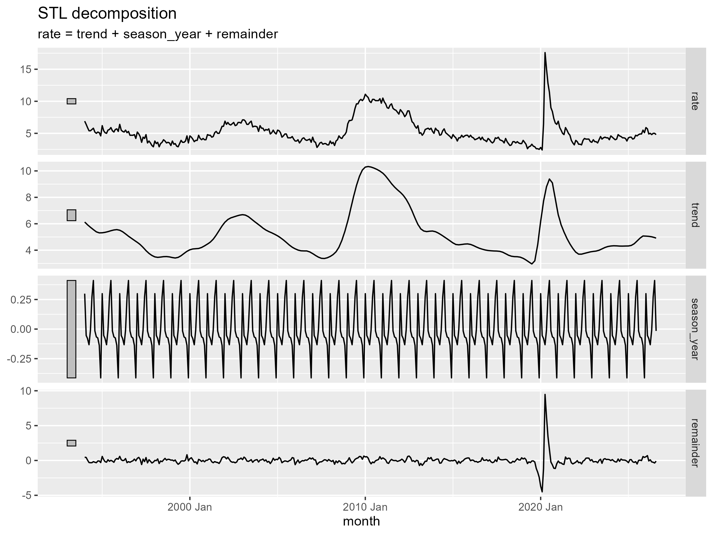
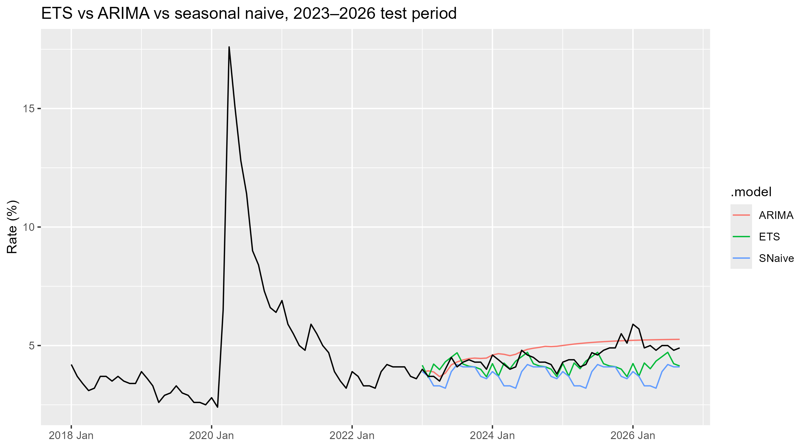
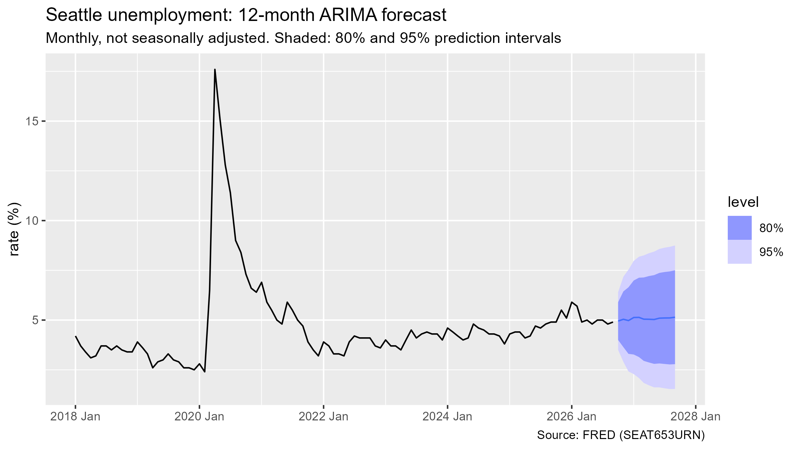

#ARIMA beat five alternatives with about half the benchmark’s error, and forecasts 5.1% unemployment for Sep 2027 (95% range 1.5–8.8%).#
---

## **Question**

Unemployment is one of the biggest drivers of loan defaults: when people lose their jobs, they lose their income and can't make their payments. Lenders like credit unions and banks therefore forecast unemployment to decide how much money to set aside for future loan losses. This project asks how accurately time-series models can forecast Seattle's unemployment rate 12 months ahead, and what range of outcomes a lender should plan for.

## **Data**

The data is FRED series SEAT653URN, the monthly unemployment rate for the Seattle-Tacoma-Bellevue metro area from January 1994 to September 2026. It is not seasonally adjusted, so the normal within-year swings are still in the data. October 2025 is missing because of the federal government shutdown, so I filled it by carrying the September value forward to keep the series unbroken.

Figure 1. Seattle-area unemployment rate, monthly, Jan 1994 to Sep 2026. Spikes mark the 2001, 2008 and 2020 recessions.

## **Methods**

I started by exploring the series. The rate mostly sits between about 2.5% and 7.5%, with large spikes in the 2001, 2008 and 2020 recessions and a repeating seasonal pattern each year. Splitting the series into trend, seasonal and leftover parts showed that the long-run trend drives most of the movement, while the seasonal swing is about ±0.4 points.

To test the models fairly, I trained them on data through December 2022 and held back January 2023 to August 2026 (44 months) to check their forecasts against what actually happened. I first fit four simple benchmarks (mean, naive, seasonal naive and drift) to set a bar that any serious model has to beat. Then I fit two standard forecasting models, ETS and ARIMA, and scored all six on three error measures: RMSE, MAE and MAPE. After choosing the winner, I refit it on all the data through September 2026 to produce the final 12-month forecast.

Figure 2. The series split into trend, seasonal and leftover parts. The trend drives most of the movement; the seasonal swing is under half a point.

## **Results**

ARIMA was the most accurate model on all three error measures. Its typical miss (RMSE) was 0.47 percentage points, about half the 0.91 of the best benchmark, seasonal naive, and its average percentage miss (MAPE) was 9.0% versus 15.9%. ETS came second; it reacted almost entirely to the latest month, which made it behave like a smarter naive forecast.

Figure 3. Forecasts vs. actual over the 2023–2026 test period. ARIMA stays closest to the actual rate over time, while seasonal naive runs too low.

| Model                           | RMSE | MAE  | MAPE  |
|---------------------------------|------|------|-------|
| ARIMA                           | 0.47 | 0.40 | 9.0%  |
| ETS                             | 0.63 | 0.44 | 9.3%  |
| Seasonal naive (best benchmark) | 0.91 | 0.75 | 15.9% |

ARIMA also passed its health checks. Its leftover errors showed no remaining pattern (Ljung-Box p = 0.80), meaning the model captured the structure in the data, and all 44 test months fell inside its 95% prediction interval.

The final forecast puts Seattle's unemployment rate at about 5.1% in September 2027, with a 95% range of 1.5% to 8.8%. For a lender, 5.1% is a reasonable baseline for reserves, and the upper end near 8.8% is a sensible stress-test scenario.

Figure 4. 12-month ARIMA forecast to Sep 2027 with 80% and 95% prediction intervals.

## **Limitations**

The forecast range is wide mainly because of one event: the 2020 COVID spike. When I refit the model without the COVID months, the range shrank by about a third (new range of 2.4% to 7.1%), so much of the uncertainty comes from that single shock. The model also uses only unemployment's own history, with no other economic drivers like job openings or interest rates. Finally, the data is not seasonally adjusted and the October 2025 value is filled in from September rather than real.

## **Glossary**

- RMSE (Root Mean Squared Error): Square each miss, average the squares, then take the square root. Squaring makes big misses count much more than small ones.

- MAE (Mean Absolute Error): The average size of the misses, ignoring whether each one was too high or too low (that's the "absolute" part, so misses in opposite directions don't cancel out).

- MAPE (Mean Absolute Percentage Error): The average miss as a percentage of the actual value. A MAPE of 9% means forecasts were off by about 9% of the true rate on average.

- Why MAE is never bigger than RMSE: RMSE squares the misses, so large misses pull it up more. The two are equal only when every miss is the same size.

- ARIMA, AR (AutoRegressive): How much this month's value depends on recent past values. If recent values didn't help, AR would be 0; in my model it's 1, meaning last month matters.

- ARIMA, I (Integrated): Whether the model works with the rate itself or with month-to-month changes. Mine is 0, so it uses the rate itself, because Seattle unemployment tends to drift back toward its long-run average (about 5.3%).

- ARIMA, MA (Moving Average): How much the model corrects itself using its own recent forecast mistakes, or shocks.

- Ljung-Box test: A check on the model's leftover errors to see whether any pattern is still in them. A high p-value (mine was 0.80) means no pattern was left, so the model captured the structure in the data.

- Prediction interval vs confidence interval: A prediction interval is the range where a single future value will likely fall (95% of the time for a 95% interval). A confidence interval is the range for an estimated average or model coefficient. Prediction intervals are wider because they also include the month-to-month randomness of individual values.
